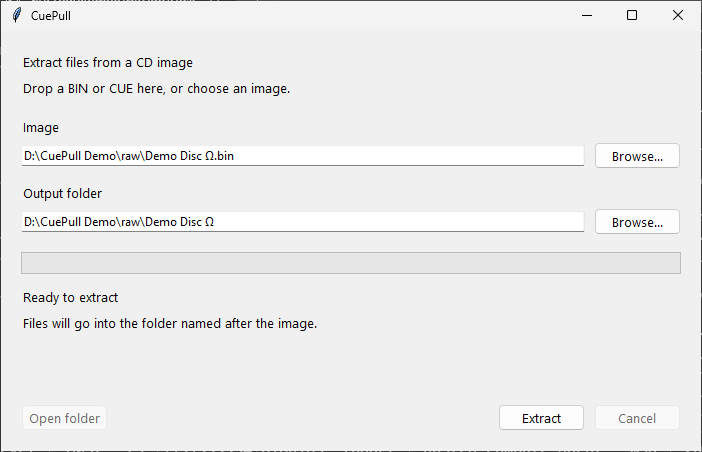
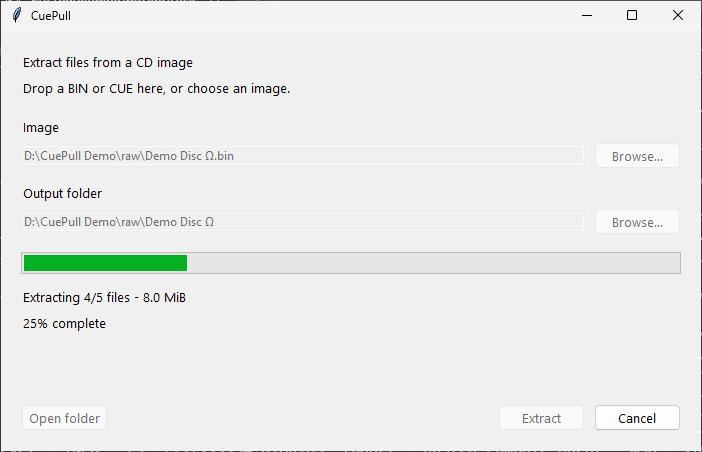
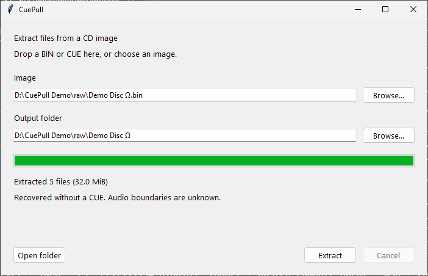

# CuePull - free BIN/CUE extractor for Windows

**[Download CuePull for Windows](https://github.com/astrobleem/cuepull/releases/download/v0.2.0/CuePull-0.2.0-windows-x64.zip)**
| [Source and other platforms](#source-and-other-platforms)
| [Tests](https://github.com/astrobleem/cuepull/actions)

Free CD image extraction. No mounting, installer, admin access, accounts,
ads, telemetry, or update nags. Windows builds include Python and need no
Python installation. Your original image is opened read-only.

For legacy Windows development, see the separate [CuePull32 native C candidate](native/README.md).
It targets XP/98 but still needs actual guest qualification; v0.2.0 remains the
modern Windows release.

## how to extract bin/cue

1. Download **CuePull-0.2.0-windows-x64.zip** from the release page.
2. Unzip it and keep the whole **CuePull** folder together.
3. Drag your **BIN or CUE onto CuePull.exe** in Explorer.

Extraction starts immediately in a folder named after the image, next to it:

```text
Downloads/
  example.bin
  example.cue          # optional
  example/            # extracted files go here
```

If `example` exists, CuePull creates `example (2)`, then `example (3)`, etc.
Existing files and originals are preserved. The result window stays open.
Click **Open folder** to see the files. Click **Cancel** to stop; partial files
remain in that output folder with an incomplete manifest.

Missing CUE? Drop the BIN anyway. CuePull recovers a confidently identifiable
ISO data volume automatically. Unknown/audio-only images and ambiguous volumes
receive a useful error. Dropping a matching BIN+CUE pair makes one extraction.
Spaces and Unicode in image paths are supported.

You can also double-click **CuePull.exe**, drop an image into its window or
click **Browse**, adjust the output folder if desired, then click **Extract**.
In-window drops select the image; they do not start extraction on their own.

This release targets **Windows 10/11 x64**. It is unsigned, so Windows may show
an unknown-publisher or SmartScreen warning. Verify the official release and
`SHA256SUMS.txt`, and follow your security policy. CuePull does not bypass
warnings or change Windows security settings.

## CuePull in action

These are actual screenshots of the CI-built Windows app using an original
synthetic demo disc. No commercial disc content or user paths are shown.

Choose or drop an image in the window, then click Extract:



Dropping a BIN onto the EXE starts extraction automatically:



The result stays visible, with an Open folder button:



## Extract BIN without CUE

Drop the BIN onto `CuePull.exe`. No replacement cue sheet is needed for a
single confidently identifiable ISO 9660/Joliet volume in a supported sector
layout. CuePull checks sector headers, descriptors, bounds, and directory
structure. Unknown/audio-only images fail clearly; several valid volumes
require an explicit choice through the CLI. Missing CUE recovery cannot
reconstruct original audio boundaries, pregaps, or session information.

## FAQ

**Why might 7-Zip fail on a BIN file?** The `.bin` extension is used for many
formats. Raw CD images may contain 2352-byte sectors and audio tracks rather
than a plain ISO byte stream. Recognition depends on the actual format, not
the extension; some BIN files can be opened by archivers. CuePull handles the
supported CD sector layouts before reading their ISO 9660/Joliet files.

**Do I need to mount or burn the image?** No. CuePull reads the image directly.

**Are audio tracks extracted?** Audio is currently skipped. CUE track details
are recorded in the manifest; without a CUE, audio boundaries are unknown.

**Is it free?** Yes. Original CuePull code is MIT licensed. The bundled parser
and runtime retain their own open-source licenses. No trial, account, or ads.

## Source and other platforms

The source CLI runs on Windows, Linux, and macOS with Python 3.10+. The optional
source GUI uses Tkinter; native drag/drop and packaged EXEs are currently
Windows-only. Native macOS/Linux application bundles are not provided.

Download the source ZIP, then:

```sh
python run.py gui
python desktop.py /path/to/example.bin     # automatic sibling-folder extraction
python run.py inspect /path/to/example.cue
python run.py list /path/to/example.cue
python run.py extract /path/to/example.cue /path/to/new-folder
python run.py verify /path/to/example.cue /path/to/extracted-folder
```

Source checkouts install the pinned parser with
`python -m pip install --only-binary=:all: --require-hashes -r requirements.txt`.
The ready source ZIP already includes its unmodified source.

## Formats and safety

CuePull supports ISO 9660/Joliet files in MODE1/2048, MODE1/2352, and MODE2
Form 1 (2352/2336) sectors. It streams file contents and shows progress.
Audio tracks are skipped, with their CUE information recorded in the manifest.

Output paths, symlinks/reparse points, unsafe CUE references, and Windows name
collisions are checked. Source names are preserved in a manifest when output
names are normalized. Existing destinations are never merged or overwritten.
Unsupported formats fail clearly. See [formats, recovery, verification and
source instructions](docs/FORMATS.md) for the full supported/unsupported list.

## Building and testing

GitHub Actions tests the portable source on Windows/Linux/macOS with Python
3.10/3.12. A separate [Windows build](https://github.com/astrobleem/cuepull/actions/workflows/windows-build.yml)
uses hash-pinned PyInstaller and dependencies to produce the portable EXEs.
It tests native file-drop messages, automatic launch arguments, raw BIN/CUE
extraction, progress, cancellation, errors, safe suffixes, and file content
with external Python paths removed. Actual window screenshots use generated
synthetic fixtures, never a user's disc or desktop.

To reproduce on Windows x64 with Python 3.12:

```sh
python -m pip install --only-binary=:all: --require-hashes -r requirements.txt -r build-requirements.txt
python -m unittest discover -s tests -v
python tools/build_windows.py
python tools/test_windows_bundle.py dist/CuePull build/frozen-test
```

The portable folder keeps the runtime beside the EXEs for predictable startup,
without extracting it into a temporary folder on each launch. Optional
**CuePull-cli.exe** provides the same inspect/list/extract/verify commands.

CuePull's original code is **MIT** licensed. PyCdlib remains **LGPL 2.1** and
is bundled as replaceable, unmodified source in `dependencies/pycdlib`.
Project source/build instructions and all runtime notices accompany the EXEs.
See [LICENSE](LICENSE) and [third-party notices](THIRD_PARTY.md).
